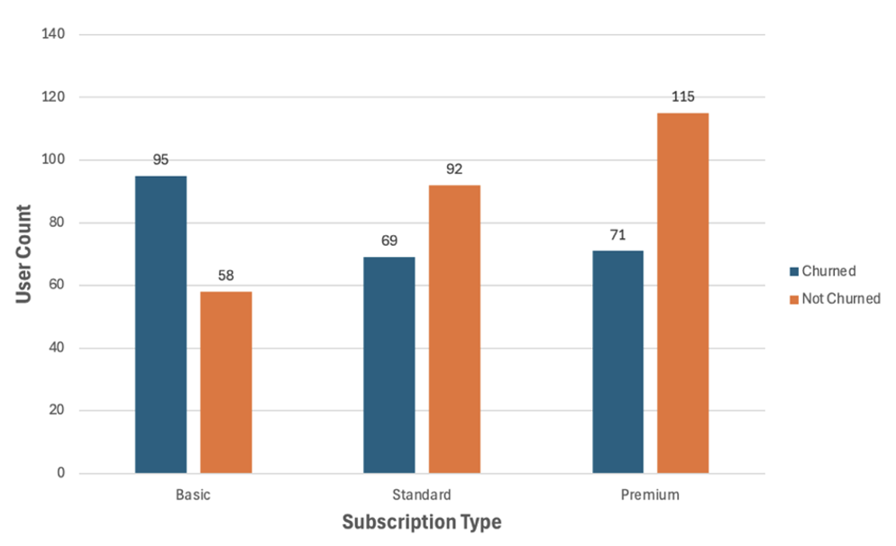
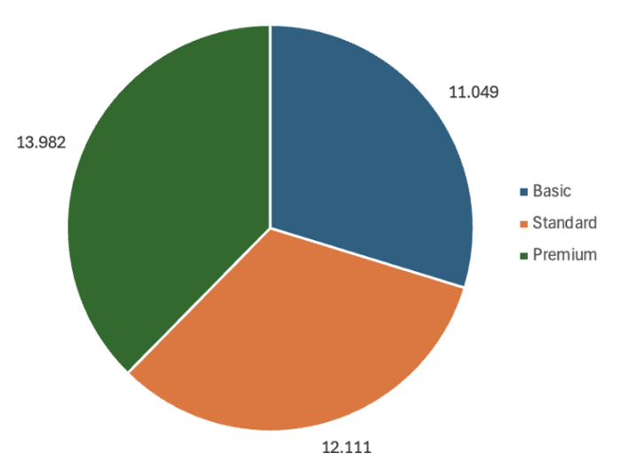
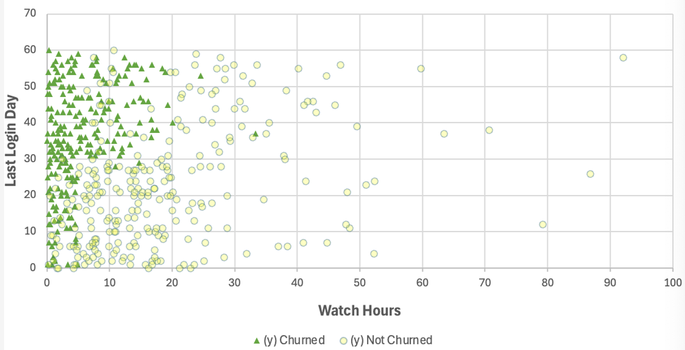
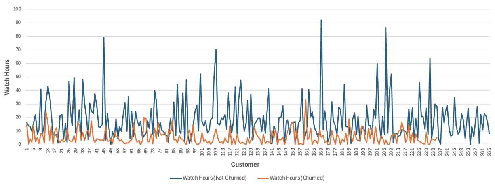
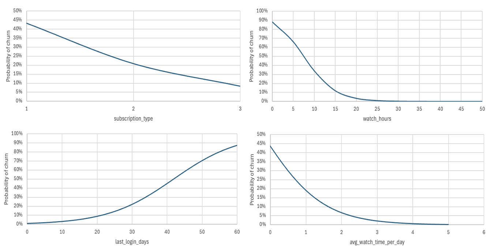

# Netflix Customer Churn Analysis

A binomial logistic regression model built in Excel to find what drives customer churn at Netflix, followed by four customer segments with tailored retention strategies.

## Business Problem
Retaining subscribers is central to Netflix's revenue and customer lifetime value, yet price rises and competition keep pushing customers to cancel. Which customer behaviours and plan types signal that someone is about to churn, and how should Netflix prioritise its retention efforts?

## Data
- **Source:** [Netflix Customer Churn dataset on Kaggle](https://www.kaggle.com/datasets/abdulwadood11220/netflix-customer-churn-dataset/data) (publicly available)
- **Size:** 5,000 customers and 14 variables in the full dataset. The first 500 observations were used, of which 235 churned (47%) and 265 stayed
- **Variables used:**
  - `churned` (0 = stayed, 1 = churned), the outcome
  - `subscription_type` (Basic = 1, Standard = 2, Premium = 3)
  - `watch_hours`
  - `last_login_days`
  - `avg_watch_time_per_day`
- **Preparation:** no missing values; subscription type was recoded into numeric levels

## Tools Used
Microsoft Excel (formulas, charts and the Solver add-in for estimating the model)

## Approach
1. **Descriptive analytics:** compared churned and retained customers on each engagement measure
2. **Data visualisation:** charted churn by subscription type, and watch hours against days since last login
3. **Predictive analytics:** built a logistic regression model in Excel. For each customer, the linear predictor was converted into a churn probability, then the log-likelihood was calculated, and Solver found the coefficients that best fit the data:

```
Linear predictor = β0 + β1·subscription_type + β2·watch_hours
                      + β3·last_login_days + β4·avg_watch_time_per_day
```

4. **Model testing:** compared the full model with a null model (overall churn rate only) using a likelihood ratio test and McFadden's R-squared
5. **Prescriptive analytics:** used predicted churn probabilities to define risk bands and four customer groups, each with its own retention plan

## Key Findings

### Churned customers are far less engaged
Churned customers watch fewer hours, log in less recently and watch much less per day:

| Measure | Churned | Retained |
|---|---|---|
| Mean watch hours | 5.67 | 18.53 |
| Mean days since last login | 36.6 | 22.7 |
| Mean average watch time per day | 0.17 | 1.56 |

Retained customers also include the heaviest viewers, with up to 92 watch hours against a maximum of about 33 for churned customers.

### Churn falls as the subscription level rises
About 62% of Basic subscribers churned, compared with about 43% of Standard and 38% of Premium subscribers. Premium users also watch more: about 26.5% more hours than Basic users, and Standard users about 9.6% more.

  <p align="center">
  <br>
  <em>Churn by subscription type</em>
</p>

  <p align="center">
  <br>
  <em>Average watch hours by subscription type</em>
</p>

### Low engagement and long inactivity go together
Churned customers cluster at low watch hours with 30 to 60 days since their last login, while retained customers are spread across all watch levels and mostly logged in within the last 30 days.

  <p align="center">
  <br>
  <em>Customer churn by watch hours and days since last login</em>
</p>

  <p align="center">
  <br>
  <em>Watch hours of churned vs non-churned customers</em>
</p>

### What the logistic regression shows
After controlling for the other variables:

- Moving up one subscription level cuts the odds of churn by about 65%
- Each extra hour of total watch time cuts the odds of churn by about 23%
- Each extra unit of average daily watch time cuts the odds of churn by about 69%
- Each extra day since last login raises the odds of churn by about 11%

### How predicted churn changes with each variable
For each chart, one variable was varied while the other three were held fixed. Churn probability falls as engagement and plan level rise, and it climbs sharply once a customer has been inactive for around a month.

  <p align="center">
  <br>
  <em>Predicted probability of churn vs variables</em>
</p>


### The model fits well
- Likelihood ratio test: D = 399.63 with 4 degrees of freedom, p ≈ 3.35 × 10⁻⁸⁵, so the model fits far better than one that only uses the overall churn rate (47%)
- McFadden's R-squared ≈ 0.58, a strong fit for a logistic model. It is a relative improvement over the null model, not "58% of churn explained"

## Recommendations
Predicted churn probability was split into high (≥ 0.7), medium (0.4 to 0.7) and **low (< 0.4) risk bands, then combined with the predictors to form four groups:

| Group | Who | Retention strategy |
|---|---|---|
| **1. High risk, low engagement** | Probability ≥ 0.7, under 5 watch hours, over 30 days since last login | Win-back email campaign with new content in their favourite genres, plus temporary discounts or free trials of premium content |
| **2. High risk, Basic plan** | Probability ≥ 0.7, Basic subscription | Encourage upgrades to Standard or Premium, or strengthen the current plan with discounts |
| **3. Medium risk, light viewers** | Probability 0.4 to 0.7, under 0.5 average daily watch time | Treat as an early-warning group: personalised thumbnails with favourite actors and push notifications about new content in their genres |
| **4. Low risk, heavy users** | Probability < 0.4, high watch hours and daily watch time | Keep with general brand marketing, release-date updates and loyalty perks such as early access |

Targeting the risky groups first avoids overspending the retention budget on loyal, already engaged customers.

## Limitations and Next Steps
- Since Excel can not process 5,000 observations, 500 observations were used, so results may not generalise to all 5,000 customers
- Variables such as region, favourite genre, device type and satisfaction were left out
- Next steps: add the omitted variables, test on the full dataset, and compare against random forest, gradient boosting or a logit leaf model

## Repository Structure
```
netflix-customer-churn-analysis/
├── README.md
├── report/        ← full report (PDF)
├── data/          ← Excel workbook with the model
└── images/        ← charts used in this README
```

## How to Use the Workbook
1. Download `data/Netflix_customer_churn.xlsx` and open it in Microsoft Excel
2. To re-estimate the coefficients, enable the Solver add-in (File → Options → Add-ins → Manage Excel Add-ins → Go → Solver Add-in), then open Data → Solver
3. Set the objective cell to the sum of the log-likelihood, choose the coefficient cells as the variable cells, and solve

## Author
Hashen Rathnayake | [LinkedIn](https://www.linkedin.com/in/hashen-rathnayake-074885207/)
